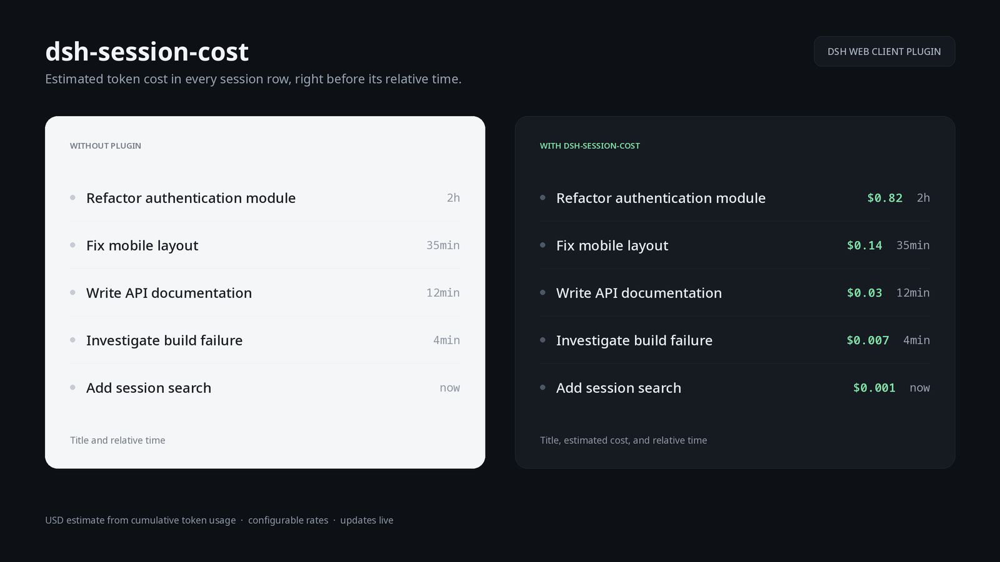

# dsh-session-cost

A small client plugin for [DeepSeek Harness](https://github.com/deepseek-ai/deepseek-harness) that shows an estimated token cost in every sidebar session row, just before its relative update time.



*Screenshot uses demo workspaces and sessions.*

## What it does

- Reads the cumulative `tokenUsage` session projection: uncached input, cache read, cache write, and output tokens.
- Prices each bucket with configurable USD rates per one million tokens.
- Renders the result before the row's `17min`-style timestamp, e.g. `$1.98 1h`.
- Updates live as new usage arrives; it keeps no state of its own and sends nothing over the network.

The figure is an estimate, not a billing record.

## Default rates

| Bucket | USD per 1M tokens |
| --- | ---: |
| Input (cache miss) | 0.28 |
| Cache read | 0.028 |
| Cache write | 0.28 |
| Output | 0.42 |

Override them in the browser console without rebuilding:

```js
localStorage.setItem('dsh-session-cost:rates', JSON.stringify({
  input: 0.28,
  cacheRead: 0.028,
  cacheWrite: 0.28,
  output: 0.42
}))
```

## Installation

The plugin is a package directory, not an npm bundle. The installer copies it to `$DSH_HOME/plugins/dsh-session-cost`, adds one loader entry to the profile's `cordis.patch.yml`, and keeps a timestamped backup of that file. It defaults to the `web` profile and is safe to run again.

### Linux / macOS

```bash
git clone https://github.com/pietrusiewicz/pietrusiewicz.github.io.git
cd pietrusiewicz.github.io/dsh-session-cost
./install/install-linux.sh
# or another profile:
./install/install-linux.sh tui
```

### Windows

From the same plugin directory, double-click `install\install-windows.cmd`, or run:

```powershell
powershell -ExecutionPolicy Bypass -File .\install\install-windows.ps1
# or another profile:
powershell -ExecutionPolicy Bypass -File .\install\install-windows.ps1 -Profile tui
```

The scripts need Node.js (DSH already requires it). Set `DSH_HOME` to install into a non-default DSH home. Start DSH once with the target profile before installing, so its profile directory exists.

After installing, restart DSH (or wait for the live profile reload) and refresh the browser tab.

### Manual installation

Copy this directory anywhere, then add the entry to `$DSH_HOME/profiles/<profile>/cordis.patch.yml`:

```yaml
- insert:
    - id: session-cost
      name: file:///ABSOLUTE/PATH/TO/dsh-session-cost/lib/index.js
```

Use forward slashes in the URL. On Windows that means:

```yaml
      name: file:///C:/Users/you/dsh-session-cost/lib/index.js
```

The package's `dsh.client` declaration serves `lib/client.js` to the Web client; the Host entry in `lib/index.js` is intentionally a no-op.

### Uninstall

```bash
./install/uninstall-linux.sh        # Linux / macOS
```
```powershell
install\uninstall-windows.cmd       # Windows
```

Uninstall removes the managed entry and the installed plugin directory, and leaves a backup of the patch file.

## Layout

| Path | Role |
| --- | --- |
| `lib/client.js` | Browser plugin: frame-wide probe that decorates sidebar rows |
| `lib/index.js` | Host loader entry (no Host-side behavior) |
| `package.json` | Package metadata and `dsh.client` declaration |
| `install/` | Linux/macOS shell and Windows PowerShell install/uninstall scripts |

## Limitations

- Pricing is a flat per-million rate; sessions that used several models are priced with the same table.
- The badge is injected through a `MutationObserver` and a CSS pseudo-element, because DSH has no trailing-slot seat between the sidebar row title and its relative time. A future slot there would remove the DOM dependency.
